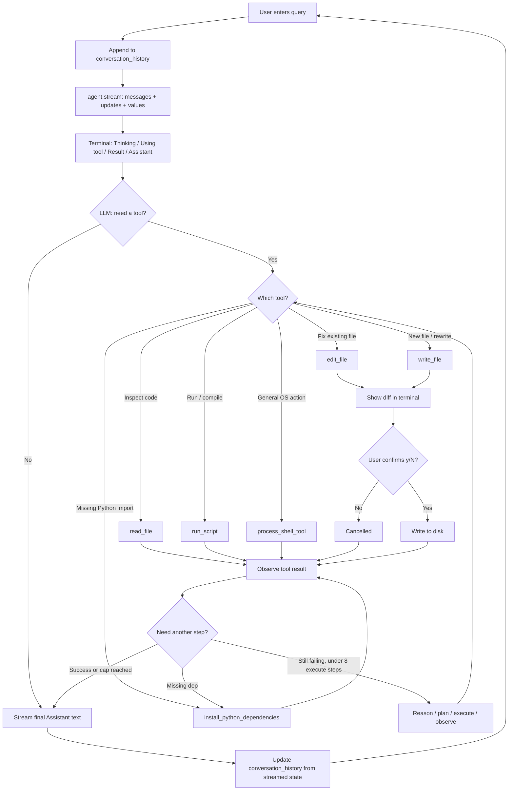
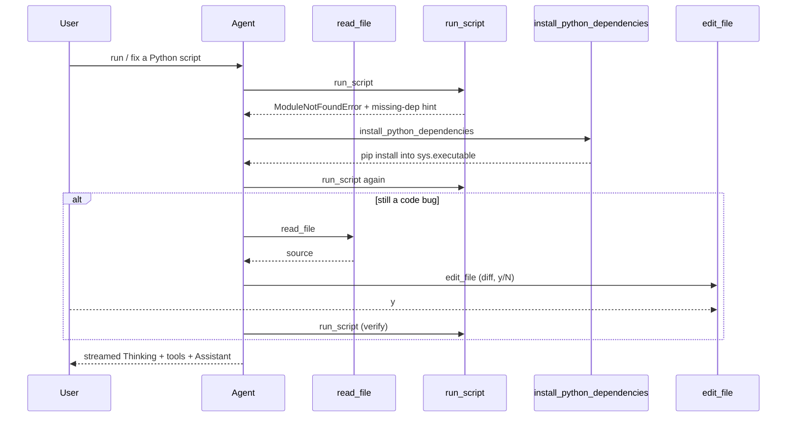

## Coding Assistant Agent

A terminal coding agent that writes, reads, edits, and runs programs, then verifies the output. It streams the model’s **thinking**, **tool calls**, and **final answer** live (similar to Cursor / Copilot), and it can install missing Python packages into the same interpreter used to run scripts.

The agent lives in `coding_assistant/`. Entry point: `coding_assistant/agent.py`. Tools: `coding_assistant/tool.py`.

### What it does

- Interprets a chat prompt and chooses tools (read / write / edit / run / shell / pip).
- Streams Groq reasoning tokens under **Thinking**, then tool use, then **Assistant**.
- Runs scripts in the current environment and uses STDOUT/STDERR as evidence.
- If a Python run fails with `ModuleNotFoundError` / `ImportError`, installs the package with `python -m pip` and re-runs.
- Fixes code with a confirm-before-write diff, then re-runs until the output is correct (capped loop).
- Keeps conversation history (including tool traces), trimmed to the last 40 messages.

The model is **Groq** `openai/gpt-oss-20b` with `streaming=True`, `reasoning_format="parsed"`, and `reasoning_effort="high"`. `process_shell_tool` uses a separate Groq call to turn natural language into one OS command.

---

## Tools

| Tool | Purpose |
| --- | --- |
| `read_file` | Read a file with line numbers. |
| `run_script` | Compile if needed, then execute. Languages: `.py`, `.js`, `.ts`, `.rb`, `.sh`, `.ps1`, `.rs`, `.go`, `.c`, `.cpp`, `.java`. |
| `edit_file` | Unique find-and-replace. Shows a diff and asks `y/N` before writing. |
| `write_file` | Create or overwrite a file. Also asks `y/N`. |
| `process_shell_tool` | General OS actions (folders, listing, disk usage, git). **Not** for Python packages. |
| `install_python_dependencies` | `sys.executable -m pip install …` into the same interpreter `run_script` uses. Maps common import names (`cv2` → `opencv-python`, `sklearn` → `scikit-learn`, `PIL` → `Pillow`). JAX and other PyPI names pass through as-is. |

Python scripts are launched with `sys.executable` (not a hardcoded `python` / `pip3`). If a `.py` run is missing a module, `run_script` appends a hint: `MISSING PYTHON DEPENDENCY: 'numpy'`.

### Path resolution (`run_script` / file tools)

Accepts:

- Absolute path: `/Users/me/project/main.rs`
- Relative path: `subdir/train.py` or `../scripts/test.py`
- Home path: `~/Documents/scripts/train.py`
- Bare filename: `hello.py` — checked in the current directory, then `scripts/`, then Desktop / Documents / Downloads

---

## Agent workflow



### Reason / plan / execute / observe

When you ask to **run**, **fix**, or **make a script produce the right output**, the agent does not stop after one try:

1. **Reason** from real code and real STDOUT/STDERR.
2. **Plan** the smallest next action.
3. **Execute** that tool.
4. **Observe** the result and loop.

**Missing Python packages (before editing code):** install with `install_python_dependencies`, then `run_script` again, until imports succeed.

**Code bugs:** `read_file` → diagnose → `edit_file` → `run_script`. Repeat until the run succeeds **and** the output matches the request. Cap: **8 execute steps** after the first run; then it stops and asks how to proceed.

It must not claim success unless it actually re-ran the script and saw the output.



---

## Terminal UI

On startup you should see:

```text
Agent Ready! (streaming + thinking enabled)
----------------
```

During a turn the printer streams:

1. **Thinking** — Groq `reasoning_content` (dim italic when the terminal supports color)
2. **Using \<tool\>** — tool name and JSON arguments
3. **Result from \<tool\>** — truncated STDOUT/STDERR or pip output
4. **Assistant** — the user-facing reply, token by token

Set `NO_COLOR=1` to disable ANSI colors. Type `exit` to quit.

`edit_file` / `write_file` still pause the stream for:

```text
Apply this change to /path/to/file? [y/N]:
```

---

## Setup and run

1. Put API keys in a `.env` at the repo root (loaded with `override=True`):
   - `GROQ_API_KEY` — required for the chat model and shell conversion
   - `OPENAI_API_KEY` — still required at process start (`agent.py` exits if it is missing)
2. From the repo:

```bash
cd coding_assistant
python3 agent.py
```

3. Prompt in the terminal. Paths can be absolute, relative, `~`, or a bare filename (see above).
4. Type `exit` to end the chat.

Restart `agent.py` after changing tools or the stream printer; a running process keeps the old code in memory.

---

## Example: write, save, run C++

```text
python3 agent.py
Agent Ready! (streaming + thinking enabled)
----------------

You: write a program to print first 10 fibonacci numbers in C++

Thinking
  User wants a C++ Fibonacci program...

Assistant
  Here’s a simple C++ program that prints the first 10 Fibonacci numbers...

You: save it as fibonacci.cpp and run it

Thinking
  I'll write the file, then run_script so g++ compiles and runs it.

Using write_file
  {
    "path_input": "fibonacci.cpp",
    "content": "..."
  }
Apply this change to .../coding_assistant/fibonacci.cpp? [y/N]: y

Using run_script
  {
    "script_path_input": "fibonacci.cpp"
  }

Result from run_script
  STDOUT:
  0 1 1 2 3 5 8 13 21 34

Assistant
  Compiled with g++ and ran fibonacci.cpp. Output: 0 1 1 2 3 5 8 13 21 34
```

`run_script` compiles `.cpp` with `g++` in a temp directory and runs the binary (timeout 300s). Same idea for `.c` / `gcc`, `.rs` / `rustc`, `.java` / `javac`, `.go` / `go run`.

---

## Example: missing Python dependency then run

```text
You: run sum_numpy_arrays.py

Thinking
  I'll execute the script, then install anything missing.

Using run_script
  {
    "script_path_input": "sum_numpy_arrays.py"
  }

Result from run_script
  STDERR:
  ModuleNotFoundError: No module named 'numpy'
  MISSING PYTHON DEPENDENCY: 'numpy' (install with install_python_dependencies using 'numpy').

Using install_python_dependencies
  {
    "packages": "numpy"
  }

Result from install_python_dependencies
  Installed numpy into /.../python3.11
  ...

Using run_script
  {
    "script_path_input": "sum_numpy_arrays.py"
  }

Result from run_script
  STDOUT:
  Array a: [1 2 3]
  Array b: [4 5 6]
  sum (a + b): [5 7 9]

Assistant
  NumPy was missing, I installed it, and the script ran with the expected sum.
```

The same path works for other pip names (including `jax`) as long as PyPI can install them within the 300s pip timeout.

---

## Example: fix a file with confirmation

```text
You: fix bugs in fibonacci.cpp

Thinking
  Read the file, run it, then apply the smallest edit.

Using read_file
Using run_script
Using edit_file

--- Proposed change to .../coding_assistant/fibonacci.cpp ---
-    const n = 10;
+    const int n = 10;
--- end of proposed change ---
Apply this change to .../fibonacci.cpp? [y/N]: y

Using run_script
Result from run_script
  STDOUT:
  0 1 1 2 3 5 8 13 21 34

Assistant
  Fixed the missing type on n, re-ran, and verified the output.
```

If you answer `N`, the agent treats the edit as not applied.

---

## Notes

- `process_shell_tool` converts a natural-language request to **one** shell command (bash on macOS/Linux, PowerShell on Windows) with absolute paths when possible.
- Do not use the shell tool to `pip install`; that is `install_python_dependencies`.
- File and script timeouts are 300 seconds.
- Conversation memory is in-process only; it resets when you quit `agent.py`.
